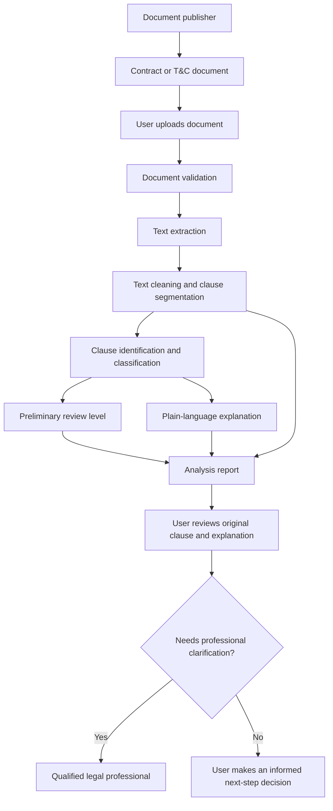

# Week 1 – System Map

## Project: AI-Powered Contract and Terms & Conditions Analyzer

This map describes the people, information, and system interactions surrounding the problem. It is a conceptual system map for the initial project scope.

## Main actors

- **Document owner / publisher:** Creates and provides the contract or T&C document.
- **User:** Receives the document and wants to understand its conditions.
- **Analyzer application:** Accepts the file, extracts text, analyses clauses, and presents findings.
- **NLP / ML components:** Process text and identify selected clause categories.
- **Explanation component:** Produces plain-language explanations grounded in the source clause.
- **Human reviewer or legal professional:** Provides qualified review when a user needs legal interpretation.

## System flow

## Information exchanged

- Uploaded document and extracted text.
- Clause segments and category labels.
- Preliminary severity or attention indicators.
- Explanation text and source-clause references.
- User feedback or corrections, if collected with consent.

## Important boundaries

- The document publisher is not assumed to provide structured data or an API.
- The analyzer should not modify or sign the original document.
- The application should not make a legal decision on behalf of the user.
- User-uploaded documents may contain sensitive information and require protection.
- Human review remains important for high-impact or unclear contractual matters.

## Key dependencies and risks

- Document quality affects text extraction.
- Clause segmentation affects the context available to the classifier.
- Limited or unbalanced training data may reduce classification reliability.
- Generated explanations may omit exceptions or introduce unsupported details.
- The user may over-rely on a severity label.

## Validation needed

Validate the user journey and pain points with actual users if required by the course. Confirm the selected document sources, clause categories, and system boundaries before implementation.
