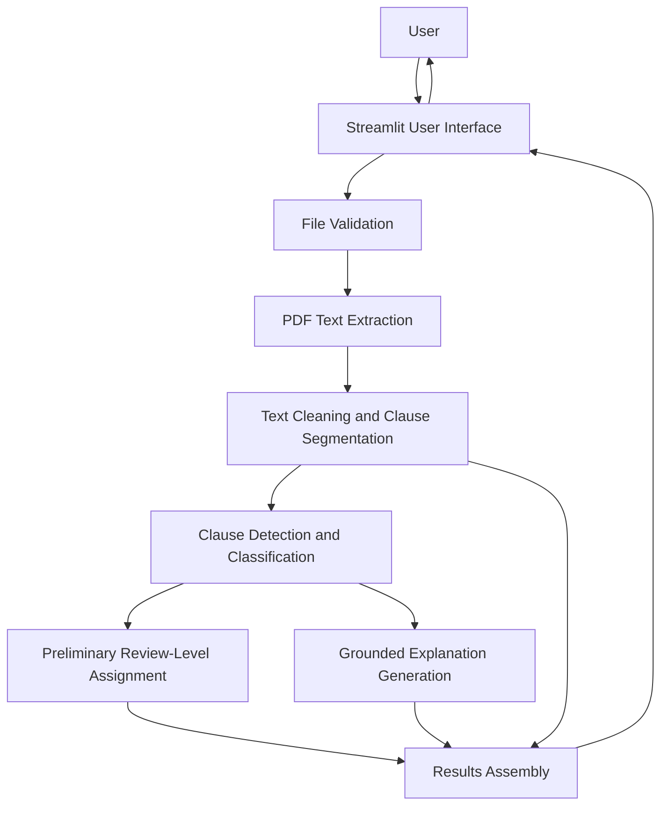

# Week 2 – Architecture Decisions

## Project

AI-Powered Contract and Terms & Conditions Analyzer

## 1. Architecture Overview

The proposed architecture separates the application into document input, text extraction, text preparation, clause analysis, explanation generation, and result presentation.

## 2. Component Responsibilities

### User interface
Accepts the document, displays progress and errors, and presents the analysis report.

### File validation
Checks file extension, size, and whether the document can be processed. It should reject unsupported inputs safely.

### PDF text extraction
Extracts text from supported text-based PDF documents. OCR may be considered later for scanned documents.

### Text cleaning and clause segmentation
Removes extraction artefacts where safe and divides the text into sections or clause segments while preserving context.

### Clause detection and classification
Identifies segments related to the supported categories. A baseline may use keyword/rule patterns or a supervised machine-learning classifier, depending on labelled data availability.

### Preliminary review-level assignment
Maps supported findings to an attention level using documented rules or an evaluated model. This label must not be described as a legal judgement.

### Explanation generation
Creates a plain-language explanation based on the original clause and its context. The output should not add conditions that are absent from the source.

### Results assembly
Combines the original excerpt, category, attention level, explanation, and limitations notice into the report.

## 3. Architecture Decision 1 – Streamlit for the Prototype Interface

**Decision:** Use Streamlit as the initial web interface framework.

**Reasoning:** The project is an AI/NLP prototype. Streamlit can provide document upload and results presentation while allowing the implementation to remain primarily in Python.

**Trade-off:** Streamlit may offer less flexibility than a separately developed frontend and backend. For the initial prototype, development speed and integration with Python-based analysis are prioritised.

**Revisit when:** The project requires more complex user accounts, production-scale deployment, or advanced frontend interactions.

## 4. Architecture Decision 2 – Extract Text Before Applying NLP

**Decision:** Use a dedicated document-processing stage before clause analysis.

**Reasoning:** The model needs readable text rather than raw PDF bytes. Separating extraction and preprocessing makes extraction failures easier to detect and test.

**Trade-off:** PDF layouts, columns, tables, and scanned pages may cause extraction errors. The first version will prioritise text-based PDFs and clearly report extraction limitations.

**Revisit when:** OCR or more advanced layout-aware document processing becomes necessary.

## 5. Architecture Decision 3 – Use an Evaluated Baseline Before a More Complex Model

**Decision:** Establish a simple baseline for clause detection/classification before selecting a more complex NLP or LLM-based approach.

**Reasoning:** A baseline provides a measurable reference and helps identify whether added model complexity improves results.

**Trade-off:** Keyword rules or traditional classifiers may struggle with context, paraphrasing, and exceptions. More advanced models may improve contextual understanding but can increase cost, complexity, and privacy concerns.

**Revisit when:** A labelled dataset is available and experiments demonstrate a justified improvement.

## 6. Architecture Decision 4 – Keep Explanations Linked to Original Clauses

**Decision:** Display each explanation with its original source excerpt.

**Reasoning:** Users need to verify why a clause was flagged. Source visibility also helps reviewers identify inaccurate or unsupported explanations.

**Trade-off:** Extracted text may not perfectly preserve the original PDF layout or page numbering. The prototype should preserve useful section or page references where feasible.

**Revisit when:** Document parsing supports more reliable layout and location tracking.

## 7. Data Flow and Trust Boundaries

- Uploaded documents are untrusted input and must be validated.
- Extracted text may contain personal or confidential information.
- Any external model/API use must be reviewed for data transfer, retention, and cost.
- Explanations must be grounded in extracted source text.
- The user remains responsible for decisions and should seek professional advice when needed.

## 8. Known Limitations

- Text extraction may fail for scanned or complex PDFs.
- Clause categories may not cover every relevant contractual condition.
- Model performance depends on the quality and coverage of labelled data.
- Severity labels are preliminary review indicators, not legal conclusions.
- Explanation generation may omit context unless the source clause and surrounding text are supplied.

## 9. Future Architecture Considerations

Potential future improvements include OCR, multilingual support, stronger document-layout processing, user feedback, secure document deletion controls, and expanded clause categories. These are not commitments for the initial prototype.
