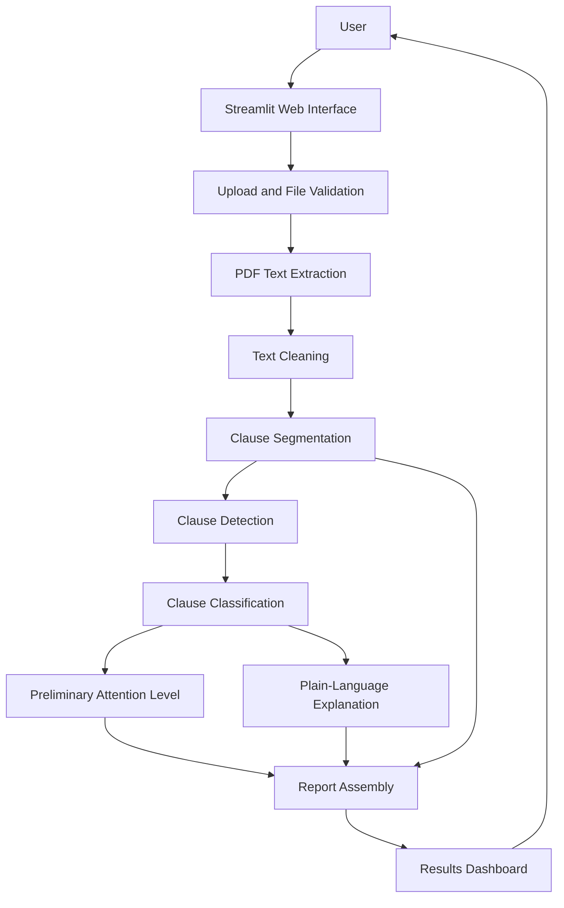

# Week 2 – System Architecture v1

The following Mermaid diagram is the editable source version of the initial architecture diagram.

## Data Flow

1. User submits a supported document through the interface.
2. File validation checks whether the input can be processed.
3. The extraction component converts PDF content into text.
4. Text preparation cleans and segments the extracted content.
5. NLP components identify and classify selected clause types.
6. The system assigns preliminary attention labels and generates source-grounded explanations.
7. The report assembly component prepares the findings.
8. The interface displays findings with original clause excerpts and limitations.

## Diagram Notes

- This is an initial conceptual architecture, not a completed implementation.
- The first version targets text-based PDF documents.
- OCR and multilingual processing are outside the initial scope unless later requirements change.
- The architecture keeps the original clause visible so users can verify the generated explanation.
- The application is an aid for understanding documents and does not provide legal advice.
