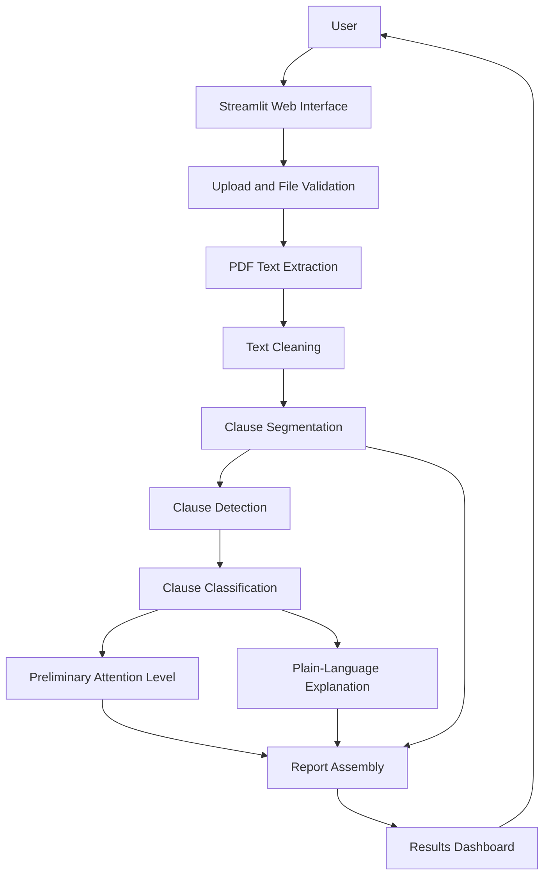

# Week 2 – System Architecture v1

The following Mermaid diagram is the editable source version of the initial architecture diagram.

## Data Flow

1. User submits a supported document through the interface.
2. File validation checks whether the input can be processed.
3. The extraction component converts PDF content into text.
4. Text preparation cleans and segments the extracted content.
5. NLP components identify and classify selected clause types.
6. The system assigns preliminary attention labels and generates source-grounded explanations.
7. The report assembly component prepares the findings.
8. The interface displays findings with original clause excerpts and limitations.

## Diagram Notes

- This is an initial conceptual architecture, not a completed implementation.
- The first version targets text-based PDF documents.
- OCR and multilingual processing are outside the initial scope unless later requirements change.
- The architecture keeps the original clause visible so users can verify the generated explanation.
- The application is an aid for understanding documents and does not provide legal advice.

---

## UNCOVER AI — Additive Project Extension (Planned)

**Updated proposed title:** UNCOVER AI: An AI-Powered Contract Analysis and Document Review Management System.

The existing AI contract/T&C analyzer remains the **core FYP component**: upload text-based PDFs, extract and prepare text, identify and categorize clauses, provide plain-language explanations, and show the supporting original excerpts. The application is now intended for **both individuals and organizational users**.

**Additional planned supporting features:**
- **Dashboard:** counts of total documents, pending review, reviewed, user-approved, and needs-attention documents; recent uploads; and a chart of detected clause categories.
- **My Documents:** saved document and analysis history, search/filter, reopen, and deletion.
- **Review Management:** user-controlled review statuses and notes, tracked separately from AI findings or processing status.
- **PDF Reports:** export identified clauses, supporting source excerpts, explanations, and limitations.
- **Basic accounts and storage:** user-specific access and document metadata/analysis persistence (SQLite proposed for the prototype).

**Important:** These are proposed additions, **not implemented or evaluated features**. An 'approved' status is a user's workflow decision, not an AI legal-safety judgment. AI-generated attention indicators must not be presented as legal conclusions. Existing lecturer lab activities and reported results remain unchanged. See [UNCOVER AI scope extension](uncover_ai_scope_extension.md) for details.

**Architecture extension:** The existing architecture is retained as version 1 of the analysis pipeline. Proposed downstream components are a SQLite-backed document store, review service, dashboard, and report exporter; user access controls apply to persisted documents.
